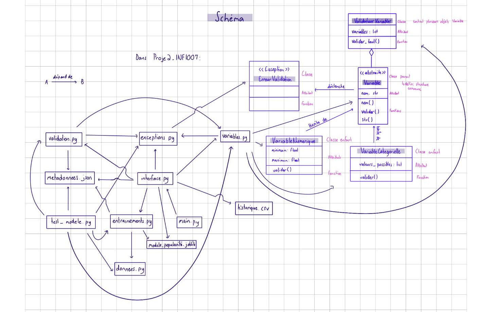

# Projet 2 — INF1007

## Description du projet

Ce projet consiste à développer une application permettant de prédire la popularité d'une chanson à partir de certaines de ses caractéristiques musicales. L'application utilise un modèle d'apprentissage automatique entraîné sur un jeu de données provenant de Spotify.

L'utilisateur peut entrer les caractéristiques d'une chanson dans une interface graphique développée avec Streamlit. L'application affiche ensuite une prédiction de popularité ainsi que des informations complémentaires sur le modèle.

## Technologie utilisée : Streamlit

L'interface graphique du projet a été développée avec **Streamlit**, une bibliothèque Python permettant de créer des applications Web interactives directement à partir de code Python.

Cette technologie a été choisie puisqu'elle permet de concevoir rapidement une interface conviviale tout en restant dans l'environnement Python utilisé pour le développement du projet.

L'application fonctionne localement sur l'ordinateur de l'utilisateur et est accessible dans un navigateur Web à l'aide d'une adresse locale.

## Installation et exécution

Toutes les commandes suivantes doivent être exécutées à partir du répertoire principal du projet.

### 1. Installer les dépendances

```bash
pip install -r requirements.txt
```

### 2. Préparer les données (facultatif)

Les fichiers de données sont déjà inclus dans le dépôt. Pour reproduire l'échantillonnage et le nettoyage :

```bash
python -m src.donnees
```

### 3. Entraîner le modèle (facultatif)

Pour entraîner à nouveau le modèle et mettre à jour les fichiers sauvegardés :

```bash
python -m src.entrainement
```

### 4. Lancer l'application

```bash
python -m streamlit run src/main.py
```

### 5. Exécuter les tests

```bash
python -m pytest
```

Pour obtenir le rapport de couverture des tests :

```bash
python -m pytest --cov=src --cov-report=term-missing
```

## Structure du projet

```text
Projet2_INF1007/
│
├── .github/
│   └── workflows/
│       └── tests.yml
│
├── .streamlit/
│   └── config.toml
│
├── donnees/
│   ├── dataset.csv
│   ├── dataset_30000.csv
│   └── dataset_30000_clean.csv
│
├── modeles/
│   ├── modele_popularite.joblib
│   └── metadonnees.json
│
├── src/
│   ├── donnees.py
│   ├── entrainement.py
│   ├── exceptions.py
│   ├── interface.py
│   ├── main.py
│   ├── validation.py
│   └── variables.py
│
├── tests/
│   └── test_modele.py
│
├── requirements.txt
├── README.md
├── DECISIONS.md
└── JOURNAL_IA.md
```

Le dossier `src/` contient les modules responsables du traitement des données, de l'entraînement du modèle, de la validation des entrées et de l'interface graphique. Le dossier `tests/` contient les tests automatisés du projet.

## Schéma de la structure du projet

Le schéma suivant présente l'organisation des différents modules et leurs interactions au sein de l'application.



## Source et préparation des données

Le jeu de données utilisé est le **Spotify Tracks Dataset**, créé par Maharshi Pandya et disponible sur [Kaggle](https://www.kaggle.com/datasets/maharshipandya/-spotify-tracks-dataset).

Le jeu de données original contient environ 114 000 chansons et 21 variables. Un échantillon aléatoire de 30 000 chansons a été sélectionné à l'aide de `random_state=42`.

Les fichiers sont inclus dans le dépôt GitHub, dans le dossier `donnees/` :

| Fichier | Description |
|---|---|
| `dataset.csv` | Jeu de données original |
| `dataset_30000.csv` | Échantillon aléatoire de 30 000 chansons |
| `dataset_30000_clean.csv` | Jeu de données après nettoyage, contenant 29 921 chansons |

Le nettoyage et l'échantillonnage peuvent être reproduits en exécutant le script `src/donnees.py` à partir du répertoire principal du projet :

```bash
python -m src.donnees
```

Le fichier `dataset_30000_clean.csv` est utilisé pour l'entraînement et l'évaluation du modèle.

## Licence du jeu de données

Le Spotify Tracks Dataset est indiqué comme étant distribué sous la licence **Open Database License (ODbL) v1.0** pour la base de données. Les contenus sont toutefois identifiés comme étant © Original Authors.

La licence ODbL autorise l'utilisation, la modification et la redistribution de la base de données sous réserve du respect de ses conditions, notamment l'attribution de la source et le partage à l'identique des bases de données dérivées. Les droits associés aux contenus doivent également être pris en compte.

- **Source :** [Spotify Tracks Dataset – Kaggle](https://www.kaggle.com/datasets/maharshipandya/-spotify-tracks-dataset)
- **Licence :** [Open Database License (ODbL) v1.0](https://opendatacommons.org/licenses/odbl/1.0/)

Les opérations d'échantillonnage et de nettoyage effectuées dans le cadre du projet sont décrites dans le fichier `src/donnees.py`.

## Exploration et nettoyage des données

Une exploration initiale a été effectuée afin de mieux comprendre les caractéristiques du jeu de données. Elle comprend notamment l'analyse des distributions, des valeurs manquantes et des valeurs aberrantes.

Les opérations de nettoyage suivantes ont été réalisées :

- Suppression de la colonne `Unnamed: 0`, qui correspond à un index inutile.
- Suppression des chansons dont la durée dépasse 20 minutes, puisqu'elles sont considérées comme atypiques pour le contexte du projet.
- Suppression des chansons dont la durée est égale à zéro.
- Suppression des chansons dont le tempo est égal à zéro.
- Vérification des valeurs manquantes, des doublons et des valeurs hors limites.

Les trois valeurs manquantes dans les colonnes `artists`, `album_name` et `track_name` ont été conservées, puisque ces variables ne sont pas utilisées par le modèle.

Après le nettoyage, le jeu de données contient **29 921 chansons**.

## Définition du problème

Le projet utilise un problème de **régression supervisée** afin de prédire la popularité d'une chanson.

La variable cible est `popularity`, dont les valeurs se situent sur une échelle de 0 à 100.

Les six variables utilisées comme entrées du modèle sont :

| Variable | Description |
|---|---|
| `danceability` | Degré auquel une chanson convient à la danse |
| `energy` | Niveau d'énergie d'une chanson |
| `tempo` | Tempo de la chanson, en battements par minute |
| `loudness` | Volume sonore moyen, en décibels |
| `duration_ms` | Durée de la chanson, en millisecondes |
| `track_genre` | Genre musical de la chanson |

## Entraînement du modèle

Le modèle utilisé est un `RandomForestRegressor` de la bibliothèque Scikit-learn.

Le prétraitement des données est effectué à l'aide d'un `ColumnTransformer` et d'un `OneHotEncoder` pour convertir la variable catégorielle `track_genre` en données numériques. Le modèle est ensuite intégré dans un pipeline afin de regrouper les étapes de prétraitement et d'entraînement.

Les paramètres principaux du modèle sont :

| Paramètre | Valeur |
|---|---:|
| Nombre d'arbres | 100 |
| `random_state` | 42 |
| `n_jobs` | -1 |

Les données sont séparées en deux ensembles :

- 80 % pour l'entraînement.
- 20 % pour les tests.

Une référence simple, correspondant à la prédiction de la popularité moyenne de l'ensemble d'entraînement, est également utilisée afin de comparer les performances du modèle.

## Évaluation du modèle

La performance du modèle est évaluée à l'aide de l'**erreur absolue moyenne (MAE)**.

La MAE représente la moyenne des écarts absolus entre les valeurs prédites et les valeurs réelles. Une valeur plus faible indique donc de meilleures prédictions.

Les résultats obtenus sont les suivants :

| Modèle | MAE |
|---|---:|
| Référence basée sur la moyenne | 18,79 |
| Random Forest | 12,80 |

Le modèle Random Forest obtient une MAE inférieure à celle de la référence. Il permet donc de mieux prédire la popularité des chansons que la simple utilisation de la moyenne.

Les calculs de la MAE sont également effectués avec NumPy afin de vérifier leur concordance avec ceux de Scikit-learn.

## Interface graphique

L'application utilise Streamlit pour permettre à l'utilisateur d'interagir avec le modèle.

Elle permet notamment de :

- Entrer les caractéristiques d'une chanson.
- Vérifier la validité des valeurs saisies.
- Obtenir une prédiction de popularité.
- Consulter l'historique des prédictions.
- Visualiser l'importance des variables utilisées par le modèle.

Les prédictions sont enregistrées dans un fichier CSV afin de conserver un historique des utilisations.

## Sauvegarde du modèle

Le modèle entraîné est sauvegardé à l'aide de Joblib dans le fichier :

`modeles/modele_popularite.joblib`

Les métadonnées associées au modèle sont enregistrées dans un fichier JSON :

`modeles/metadonnees.json`

Ces fichiers permettent à l'application de charger le modèle déjà entraîné sans devoir recommencer l'entraînement à chaque lancement.

## Programmation orientée objet et décorateurs

Le projet utilise plusieurs notions de programmation orientée objet et de décorateurs :

- `@abstractmethod` : permet de définir une méthode abstraite dans la classe de base `Variable`, que les classes dérivées doivent implémenter.
- `@property` : permet d'accéder à certaines propriétés d'un objet, notamment le nom d'une variable.
- `@pytest.fixture` : permet de préparer des données ou des objets réutilisables dans les tests.
- `@chronometrer` : décorateur personnalisé qui mesure le temps d'exécution de la fonction d'entraînement du modèle.

## Tests et couverture du code

Les tests automatisés sont réalisés avec Pytest.

Le projet contient **29 tests automatisés** qui vérifient notamment le chargement des données, la validation des entrées, les variables et les fonctions d'entraînement.

La couverture globale du code obtenue est de **41 %**.

L'intégration continue est configurée avec GitHub Actions afin d'exécuter automatiquement les tests lors des événements prévus dans le dépôt.

## Documentation consultée

- [Pandas](https://pandas.pydata.org/docs/getting_started/intro_tutorials/index.html)
- [Scikit-learn](https://scikit-learn.org/stable/getting_started.html)
- [Streamlit](https://docs.streamlit.io/get-started)
- [Pytest](https://docs.pytest.org/)